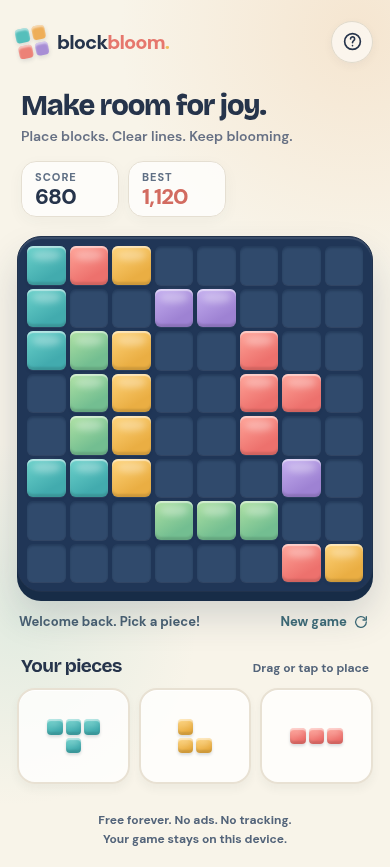

# Block Bloom

A free, ad-free block puzzle built for iPhone and desktop browsers. Place three shapes at a time on an 8×8 board. Full rows and columns clear; the game continues until none of the available pieces fit.



[View the desktop layout](docs/preview-desktop.png)

## Run locally

With Docker:

```sh
docker build -t block-bloom .
docker run --rm -p 8080:80 block-bloom
```

Open <http://localhost:8080>. To try it on an iPhone on the same Wi-Fi, serve it on your computer's LAN address using `docker run --rm -p 0.0.0.0:8080:80 block-bloom`, then open `http://YOUR-COMPUTER-IP:8080` in Safari. The game works over local HTTP. Deploy over HTTPS for offline caching and the full Home Screen web app experience.

Without Docker, run `npm run dev` (requires Python 3) and open <http://localhost:8080>. Run `npm test` for the game-rule tests.

## Play

- Drag a piece onto the board. On touch screens, it floats above your finger so you can see the landing spot.
- Or tap a piece, then tap the board square where its top-left corner should go. This also works with keyboard focus and Enter.
- Fill any row or column to clear it. Consecutive clears and multiple lines earn extra points.
- Progress and the best score are saved in this browser's local storage.

## Deployment

This is a static site. Upload the contents of `public/` to any HTTPS static host, or deploy the Docker image to a container host. No build step, API keys, database, analytics, ads, or third-party runtime requests are needed. Use HTTPS for service workers and iPhone **Share → Add to Home Screen**.

For a server with an existing Docker network named `edge`, the included `compose.yaml` builds and runs the site. Set a free host port in an untracked `.env` file:

```sh
printf 'BLOCK_BLOOM_PORT=12345\n' > .env
docker compose up -d --build
```

Replace `12345` with the chosen port. Update with `git pull --ff-only && docker compose up -d --build`. A direct `http://SERVER:PORT` URL serves the game, while offline caching on phones requires an HTTPS reverse proxy or HTTPS static host.

## Privacy and source

Game data stays in local storage on the device. The site makes no analytics or advertising requests. All fonts and icons are served locally. Source code is MIT licensed; the bundled DM Sans and Bricolage Grotesque fonts retain their SIL Open Font Licenses in `public/fonts/`.

The gameplay takes inspiration from the common 8×8 block puzzle format and open-source projects such as [10Block](https://github.com/viliceq/10block). All game code and visuals in this repository were written for Block Bloom; no third-party game code or artwork was copied.
